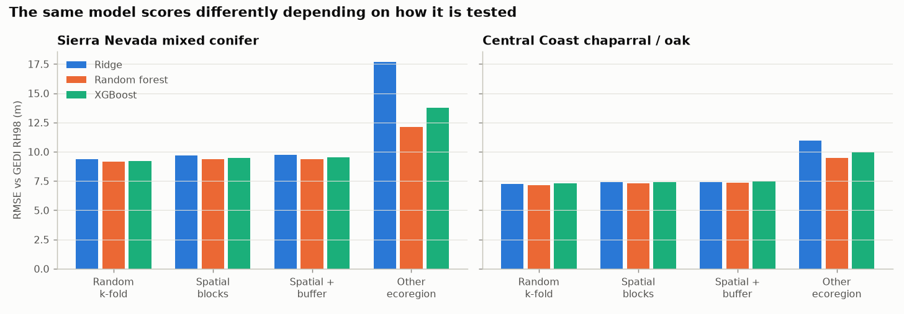
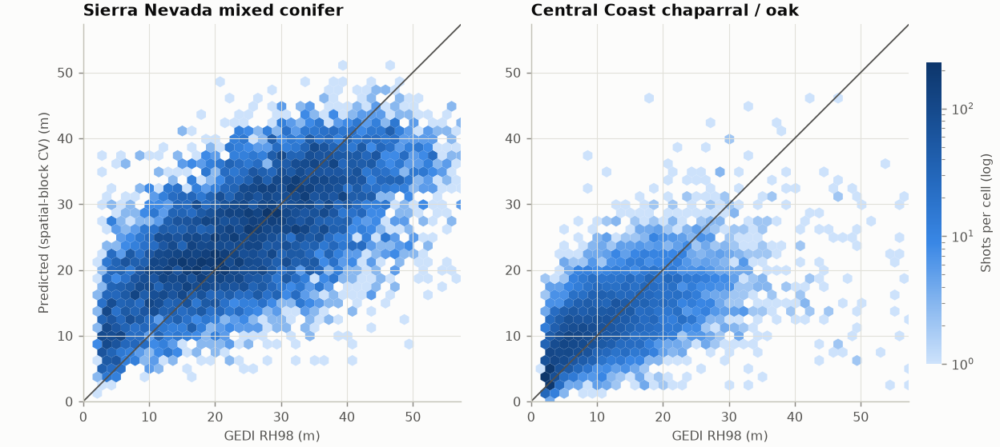
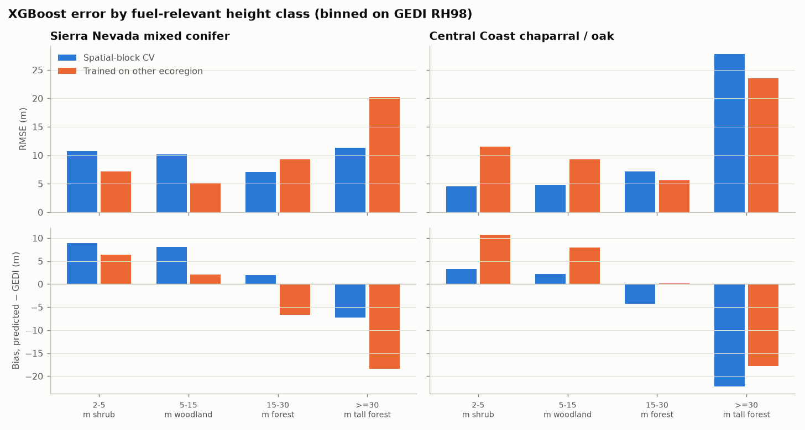
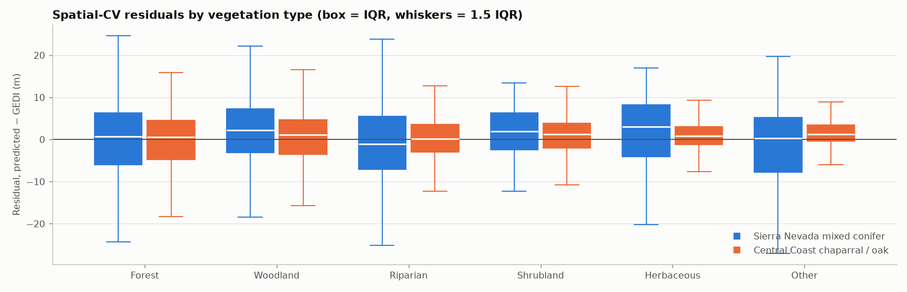
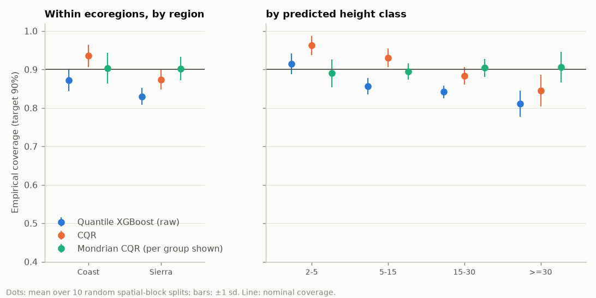
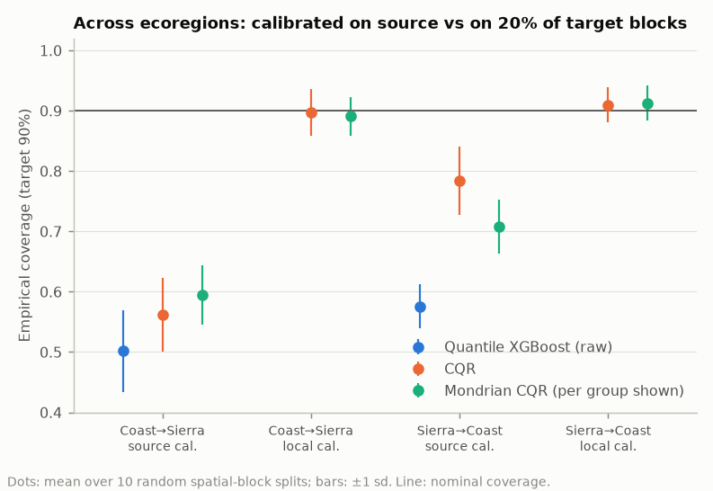
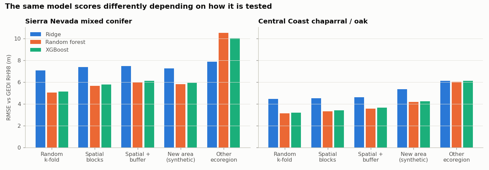

# Canopy-Height Validation for Wildfire Fuels (GEDI + Sentinel-2 + XGBoost)

A small, **validation-first** canopy-height model for fire-prone vegetation.
GEDI spaceborne LiDAR (L2A RH98) is the reference; Sentinel-2 composites and
SRTM terrain are the predictors; XGBoost is the model, compared with random
forest and ridge baselines. Most of the code is about **how the model is evaluated**:

- spatial block cross-validation instead of random splits, with the block size set by a variogram;
- train on one ecoregion and test on another, to measure geographic transfer;
- error by fuel-relevant height class and by LANDFIRE vegetation type;
- 90 % prediction intervals per sample, with checks that they really cover
  90 %, overall, per region and per predicted height class.

The modelling is deliberately simple. The question it asks is the one a fuels
product has to answer before anyone uses its maps: *how wrong is it, where,
and does the stated uncertainty hold somewhere new?*

> ### What has been run
> | | Status |
> |---|---|
> | **Real data**: 16,000 GEDI L2A shots (8,000 per region) with Sentinel-2, SRTM and LANDFIRE EVT, pulled from Google Earth Engine on 2026-10-22 | **Run.** Results in [Results on real data](#results-on-real-data); tables in `results/gee/`, figures in `figures/gee/`, frozen input in `data/gee_samples.csv`. |
> | Repeat on an earlier, independent real subsample (15,549 shots) | **Run** as a stability check (`results/gee_v1_randomcolumn/`). |
> | **Synthetic** test bed: simulated GEDI tracks over simulated landscapes with known true height | **Run.** Used to check the method before real data; **labelled synthetic wherever it appears.** |
> | pytest suite (42 tests, offline) | **Passing.** |

The structure follows my Landsat 8/9 cross-calibration project (`landsat89-xcal`):
one data contract, a GEE backend for real data, and a synthetic backend with
injected, known truth. The estimators were checked on the synthetic data
before real data was touched. The comparison in
[What the synthetic test bed got right and wrong](#what-the-synthetic-test-bed-got-right-and-wrong)
is part of the result.

---

## Why canopy height, and why GEDI

Canopy height is one of the structural layers that fire-behaviour models need
for the crown-fire side: canopy height, cover, base height and bulk density.
It is also the layer where spaceborne LiDAR gives direct measurements. GEDI
samples the land surface in 25 m footprints along sparse tracks, so producing a
wall-to-wall map means learning height from imagery and terrain, and
everything then depends on how honestly that model is evaluated.

## What it does

1. **Samples.** GEDI L2A shots, April 2019 to March 2023, in two
   contrasting fire-prone California ecoregions. The AOIs are about 40 km
   boxes, confirmed against EPA Level III ecoregions at extraction time:
   - Sierra Nevada mixed conifer (Stanislaus NF west slope), in "Sierra Nevada";
   - Central Coast chaparral/oak (southern Santa Lucia Range), in "Central
     California Foothills and Coastal Mountains".

   Shots are screened as the L2A user guide recommends: `quality_flag == 1`,
   `degrade_flag == 0`, sensitivity ≥ 0.95, full-power beams only. Shots in
   MODIS burned area during the window are dropped.
2. **Features.** For each shot: a Sentinel-2 L2A June–September median
   composite for 2020–2022 (9 bands, plus NDVI, EVI, red-edge NDVI, NBR and
   NDMI), with Cloud Score+ masking; SRTM elevation, slope, northness and
   eastness. Coordinates are deliberately left out, because the goal is a
   model that transfers to new places, not one that interpolates between
   GEDI tracks.
3. **Models.** XGBoost, random forest and ridge regression of RH98, with
   fixed hyperparameters. They are not tuned inside the evaluation folds.
4. **Validation.** Random k-fold, spatial-block k-fold, spatial-block with a
   1 km buffer, and cross-ecoregion transfer. Metrics (RMSE, bias, MAE, R²)
   are reported overall, by height class and by vegetation type.
5. **Uncertainty.** Quantile XGBoost (5/50/95 %) calibrated with
   conformalised quantile regression (CQR), plus Mondrian CQR by region or
   by predicted height class. Coverage is checked over 10 repeated
   spatial-block splits, within regions and under transfer.
6. **Error analysis.** Residuals by LANDFIRE Existing Vegetation Type
   (EVT v1.4.0), grouped into Forest, Woodland, Riparian, Shrubland,
   Herbaceous and Other by keywords in the class names.

---

## Quickstart

```bash
pip install -r requirements.txt

# Real data: reproduce every real-data number from the frozen extraction (~1 min)
python scripts/run_validation.py --samples data/gee_samples.csv

# Re-extract from Earth Engine (needs an account; ~16 min for both regions)
#   pip install earthengine-api && earthengine authenticate   (one time)
python scripts/fetch_gee.py --project YOUR_EE_PROJECT --out data/gee_samples.csv --refresh

# Synthetic test bed (no Earth Engine; ~2 min; add --fast --repeats 3 for a ~20 s smoke test)
python scripts/run_validation.py --backend synthetic

# Tests (offline)
pytest -q
```

Each run writes CSV tables, a `summary.md` and `run_info.json` (settings,
sample counts, package versions) to `results/<label>/`, and figures to
`figures/<label>/`. Extraction is separate from modelling, so
`data/gee_samples.csv` is the frozen input of every real-data number.

---

## Validation design

| Scheme | What it estimates | How |
|---|---|---|
| Random 5-fold | Nothing useful. Shown only to measure the optimism. | Shots assigned to folds at random. Neighbouring shots on one GEDI track land on both sides of the split. |
| Spatial-block 5-fold | Error in an unsampled part of the same ecoregion | The region is tiled into square blocks, and whole blocks go to folds (balanced by shot count). |
| Spatial-block + buffer | Same, more conservative | Training shots within 1 km of any test shot are also withheld. |
| Cross-ecoregion transfer | Error when deployed somewhere the model has never seen | Train on all of one region, test on the other. |
| New area (synthetic only) | The truth that CV is trying to estimate | Train on one simulated landscape, test on fresh ones. |

**Block size from the data.** The block size is the practical range of the
residual variogram of a ridge fit: the lag where semivariance reaches 95 % of
its structured rise, rounded up, with a 2 km floor. A rise under 10 % of the
sill counts as no structure; a test caught that without this rule, plain
noise produced a spurious range.

**Height classes chosen for fuels:** < 2 m (grass, low shrub), 2–5 m (shrub),
5–15 m (woodland, ladder fuels), 15–30 m (forest), ≥ 30 m (tall forest).

---

## Results on real data

16,000 screened GEDI shots (8,000 per region; median RH98 is 24.9 m in the
Sierra and 9.6 m on the coast). The variogram set 13 km blocks. Full tables
are in [`results/gee/summary.md`](results/gee/summary.md). All errors are
against GEDI RH98; no independent truth is available for real data.

### 1. Accuracy is modest, and random CV barely flatters it here

RMSE vs GEDI RH98 (m):

| Region | Model | Random 5-fold | Spatial blocks | Spatial + 1 km buffer | Other ecoregion |
|---|---|---|---|---|---|
| Sierra conifer | Ridge | 9.38 | 9.68 | 9.73 | 17.69 |
| Sierra conifer | Random forest | 9.14 | 9.35 | 9.35 | 12.10 |
| Sierra conifer | **XGBoost** | **9.23** | **9.49** | **9.52** | **13.74** |
| Coast chaparral/oak | Ridge | 7.26 | 7.38 | 7.39 | 10.94 |
| Coast chaparral/oak | Random forest | 7.16 | 7.32 | 7.34 | 9.48 |
| Coast chaparral/oak | **XGBoost** | **7.28** | **7.43** | **7.48** | **9.99** |



- **Sentinel-2 plus terrain explains only 32–40 % of the variance in GEDI
  height** (XGBoost spatial-CV R² is 0.32 on the coast and 0.40 in the
  Sierra; RMSE 7.4 and 9.5 m). Predictions are compressed toward the middle:
  tall stands are under-predicted and short ones over-predicted (scatter
  below).
- **Random k-fold is optimistic by only 2–3 %** (7.28 vs 7.43 m;
  9.23 vs 9.49 m). The 1 km buffer adds almost nothing. With this little
  explained variance, neighbouring shots share little that the model can
  exploit. Real data cannot say how much spatial CV still under-states error
  in a *new* area; the synthetic test bed suggests it can.
- **Transfer is the dominant error.** Training in the other ecoregion raises
  XGBoost RMSE by 34 % on the coast (9.99 vs 7.43 m) and 45 % in the Sierra
  (13.74 vs 9.49 m), with large biases: −8.7 m for the coast-trained model
  in the Sierra, +5.8 m for the Sierra-trained model on the coast.
- **XGBoost is not the best model here.** Random forest is best in every
  column. Within regions all three models are within 4 % of each other;
  ridge even beats XGBoost on the coast. The flexible models earn their keep
  only under transfer, where ridge collapses in the Sierra (17.7 m).



### 2. Absolute elevation is what fails to transfer

XGBoost, RMSE (m), with bias on the transferred predictions:

| Features | Sierra, within (spatial CV) | Coast → Sierra (bias) | Coast, within (spatial CV) | Sierra → coast (bias) |
|---|---|---|---|---|
| All features | **9.49** | 13.74 (−8.7) | **7.43** | 9.99 (+5.8) |
| Without elevation | 9.55 | **10.94** (−2.1) | 7.51 | **9.12** (+3.6) |
| Spectral only | 9.70 | 11.65 (−2.0) | 7.71 | 9.55 (+4.2) |

Dropping elevation cuts transfer RMSE by 20 % (Sierra) and 9 % (coast), and
shrinks the transfer bias (−8.7 → −2.1 m; +5.8 → +3.6 m), at a cost of
about 1 % in-region. The two AOIs barely overlap in elevation: 99.6 % of
coastal shots are below 1,000 m, and 92 % of Sierra shots are above it. So in transfer,
elevation forces the trees to extrapolate, and they carry the source region's
height level with them. Where the AOIs do overlap (500–1,000 m), median RH98
is 10 m on the coast and 19 m in the Sierra. **In-region CV alone would keep
elevation; a model that must generalise should drop it or replace it with
relative terrain measures.**

### 3. Where the errors are: tall forest, and short vegetation inside forest



| XGBoost, spatial CV | 2–5 m | 5–15 m | 15–30 m | ≥ 30 m |
|---|---|---|---|---|
| Sierra: RMSE / bias (m) | 10.8 / +8.9 | 10.1 / +8.1 | 7.1 / +1.9 | 11.3 / −7.3 |
| Coast: RMSE / bias (m) | 4.5 / +3.2 | 4.8 / +2.2 | 7.2 / −4.3 | 27.8 / −22.2 |

- **Tall forest saturates.** Coastal ≥ 30 m shots are under-predicted by
  22 m. There are 275 of them, at low elevation (median 373 m), mostly in
  LANDFIRE mixed evergreen woodland and redwood forest, plus 17 labelled
  annual grassland, a sign of map/shot mismatch. Sierra ≥ 30 m stands are
  under-predicted by 7 m.
- **Short vegetation inside the Sierra forest matrix** (gaps, shrubs, young
  stands at 2–15 m) is over-predicted by 8–9 m. For fuels this matters: the
  shrub and ladder-fuel strata are where the map is least reliable.
- Binning on the reference height exaggerates both ends (regression to the
  mean), so part of each bias is a binning artefact.
- **GEDI cannot see below about 2 m.** Only 1 of 16,000 screened shots has
  RH98 < 2 m (minimum 1.94 m). Grass and low shrub cannot be validated with
  GEDI at all.

### 4. Vegetation type (LANDFIRE EVT)



Within regions, the RMSE spread across vegetation groups is modest:
6.5–9.0 m on the coast (highest in Forest) and 8.1–10.7 m in the Sierra
(highest in Riparian). **Under transfer, the Sierra-trained model over-predicts coastal
Shrubland by +6.8 m and Herbaceous by +6.5 m.** This is the "green dense
chaparral read as forest" failure this project was designed to look for.
LANDFIRE "Other" (water, roads, cropland, no-data; 9.5 % of coastal shots)
is kept. GEDI reads about 2.5 m there, its floor, and a deployed map covers
those pixels too. Riparian systems are tall (median RH98 16 m on the coast,
30 m in the Sierra) and got their own group after the first extraction
showed them hidden in "Other". FBFM40 fuel models are not in the official GEE catalog, so this is
a vegetation-type breakdown, not a fuel-model one.

### 5. Prediction intervals: calibrated within a region, broken across regions

90 % intervals, pooled model; train, calibration and test sets are split by
spatial block; mean ± sd over 10 splits.

| Method | Coverage (all) | Coast | Sierra | Mean width (m) |
|---|---|---|---|---|
| Quantile XGBoost, uncalibrated | 0.849 ± 0.012 | 0.872 | 0.829 | 21.5 |
| CQR (one correction) | **0.902 ± 0.023** | 0.935 | 0.873 | 24.0 |
| Mondrian CQR by region | 0.901 ± 0.018 | **0.903** | **0.902** | 24.5 |

| Predicted height class | CQR coverage | Mondrian-by-class coverage | Mondrian width (m) |
|---|---|---|---|
| 2–5 m | 0.962 | 0.890 | 11.9 |
| 5–15 m | 0.930 | 0.895 | 19.7 |
| 15–30 m | 0.883 | 0.904 | 29.2 |
| ≥ 30 m | 0.845 | 0.906 | 32.2 |



Calibration works within ecoregions, and per-group (Mondrian) calibration
fixes the regional and height-class imbalance. **But the honest intervals
are wide:** 24 m on average and 32 m for tall forest. That is the real
uncertainty of a Sentinel-2 height model, and it is better stated than
hidden.

**Under transfer** (calibrated in the source region and applied to the other):

| Direction | Calibrated on | CQR coverage | Mean width (m) |
|---|---|---|---|
| Coast → Sierra | source region | **0.562** | 18.7 |
| Coast → Sierra | 20 % of target blocks | 0.897 | 44.3 |
| Sierra → coast | source region | **0.784** | 28.1 |
| Sierra → coast | 20 % of target blocks | 0.910 | 30.8 |



A nominal 90 % interval covers 56 % of GEDI heights in a new ecoregion.
Recalibrating on 20 % of the target region's blocks restores coverage, but
only by widening the intervals up to 2.4× (44 m). **Calibration restores
honesty, not accuracy.** The fix for accuracy is local training data, and
where to put it is a ground-truth design question.

### 6. Stability across two independent real subsamples

The first extraction (15,549 shots; see
[Extraction notes](#extraction-notes-real-data)) shares only 1,550 shots with
the final one. XGBoost results side by side:

| Metric | First subsample | Final subsample |
|---|---|---|
| Block size (variogram) | 10 km | 13 km |
| Random / spatial RMSE, coast | 7.29 / 7.53 m | 7.28 / 7.43 m |
| Random / spatial RMSE, Sierra | 9.36 / 9.57 m | 9.23 / 9.49 m |
| Transfer RMSE into coast / Sierra | 11.63 / 12.96 m | 9.99 / 13.74 m |
| Transfer RMSE without elevation, into coast / Sierra | 9.07 / 11.47 m | 9.12 / 10.94 m |
| CQR coverage within regions | 0.902 ± 0.014 | 0.902 ± 0.023 |
| CQR coverage under transfer, coast→Sierra / Sierra→coast | 0.548 / 0.788 | 0.562 / 0.784 |

The within-region metrics and the coverage results are stable. Transfer RMSE
into the coast moved by 1.6 m, so read the transfer numbers as ±1–2 m. The
variogram range is the least stable quantity: 1.8 km vs 12.8 km on the coast
between subsamples. The metrics barely care, because the random/spatial gap is
small either way.

---

## What the synthetic test bed got right and wrong

The synthetic results ([below](#synthetic-test-bed-results)) were produced
before real data was available. How they held up:

| Synthetic prediction | Real data | Verdict |
|---|---|---|
| Random CV is optimistic vs spatial CV (6–11 %) | 2–3 % | **Direction held, size did not.** The simulator had too much spatially shared, learnable structure. |
| R² ≈ 0.8, RMSE 3.4–5.8 m | R² 0.32–0.40, RMSE 7.4–9.5 m | **Far too optimistic.** Optical height signal is much weaker in reality. |
| XGBoost / RF beat ridge by 20–25 % within regions | Within 3 %; ridge beats XGBoost on the coast | **Wrong.** |
| Transfer is the dominant error (×1.7–1.8) | ×1.34–1.45, with biases of 6–9 m | **Held.** |
| Dropping elevation helps transfer | −9 % and −20 % RMSE, ~1 % in-region cost | **Held, more strongly** (nearly free on real data). |
| CQR ≈ nominal within regions; Mondrian fixes per-group | 0.902; 0.89–0.91 per region and per class | **Held.** |
| Coverage breaks under transfer (0.73–0.83) | 0.56–0.78 | **Held, worse on real data.** |
| GEDI floor: RH98 rarely < 2 m | 1 of 16,000 shots < 2 m | **Held** (it was a simulator assumption). |
| Tall forest under-predicted | −7 m (Sierra), −22 m (coast ≥ 30 m) | **Held.** |

The test bed did its job for the machinery: folds, buffers, conformal
calibration, and the reference-error decomposition below (which real data
cannot provide). It was not a forecast of real accuracy.

---

## Synthetic test bed results

**Synthetic data with known truth: these numbers test the method; they say
nothing about real-world accuracy.** One landscape per region
(40 × 40 km), 14,078 shots after screening, 3 km blocks. Full tables are in
[`results/synthetic/summary.md`](results/synthetic/summary.md); figures are in
`figures/synthetic/`.

**Evaluation schemes (XGBoost RMSE vs simulated GEDI, m).** Sierra: random
5.14, spatial 5.80, spatial + buffer 6.14, *new area (truth)* 5.95, other
ecoregion 10.02. Coast: 3.20, 3.42, 3.67, *4.24*, 6.13. Here random k-fold
understated the true new-area error by 14–25 %. Spatial blocks with a buffer
closed most, but on the coast not all, of the gap. On real data, the
equivalent "new area" check needs held-out AOIs.

**A model trained on GEDI inherits GEDI's bias** (only measurable with known
truth):

| Region | Scored against | RMSE (m) | Bias (m) |
|---|---|---|---|
| Coast | simulated GEDI | 3.42 | +0.06 |
| Coast | true height | 3.64 | **+1.94** |
| Sierra | simulated GEDI | 5.80 | −0.22 |
| Sierra | true height | 5.64 | **+1.26** |

In shrubland the model looks +0.8–0.9 m off against GEDI but is +2.6–2.7 m
off against the truth, roughly doubling a 2–3 m shrub. The size depends on the
simulator's assumed GEDI floor. The mechanism, together with the real-data
fact that GEDI almost never reports < 2 m, is why **shrub fuels need an
independent reference** (airborne LiDAR such as USGS 3DEP, or field plots).

**Intervals (synthetic):** CQR 0.899 ± 0.023 within regions; 0.73 and 0.83
under transfer; 0.89–0.91 after local recalibration.



### The synthetic backend

`data.synthetic_region()` builds a 40 × 40 km landscape per region from
Gaussian random fields: terrain, stand density, time since disturbance,
moisture, a site-productivity field with no spectral signature, a
hardwood-mix field, and soil brightness. Region-specific rules assign
vegetation type and height. Sentinel-2 reflectance is a linear canopy/soil
mixture of literature-typical endmember spectra, with height-dependent
shadowing that saturates above about 20 m and uncorrected terrain
illumination. GEDI is simulated as 8-beam passes with
RH98 = √(h² + 2²) + 0.12·D·tan(slope) + noise
(sd √(0.8² + (0.06h)² + (0.12·D·tan slope)²), D = 25 m), plus flagged and
unflagged bad shots. These are order-of-magnitude choices, not a calibrated
GEDI error model, and the real data shows the optical side was far too clean.

---

## Extraction notes (real data)

Three things broke on first contact with Earth Engine. All are fixed in
`src/canopy_fuel/gee.py`:

1. **UTM zones.** GEDI monthly rasters are tiled by UTM zone on separate
   25 m grids, and the Sierra AOI straddles 120° W. Each zone is now
   sampled on its native grid. Shots stored in both zone rasters (1,342 in
   the Sierra) are de-duplicated by shot ID (orbit, beam, shot number).
2. **Sampling was not reproducible.** The first extraction used
   `randomColumn()` plus a server-side sort, fetched with paginated
   `computeFeatures`. The order was not stable between pages, so about 2 %
   of shots came back duplicated and as many went missing. The final
   extraction keeps the shots with the lowest **deterministic per-shot hash**
   (of orbit, beam and shot number), so **it is a different subsample from
   the first**: 1,550 shots overlap. The first extraction is kept as
   `data/gee_samples_v1_randomcolumn.csv` and analysed only as the stability
   check above.
3. **Stalled requests.** One run waited 1 h 50 min on a single idle socket,
   because the client has no timeout by default. Every request now has a
   180 s client deadline and up to 4 attempts with back-off. Each region is
   fetched as 16 tiles with one non-paginated request per tile, and logged
   per tile. The final extraction took 16 minutes with no retries.

## Honest scope

- **GEDI is the reference, not the truth.** It has about 10 m geolocation
  error, slope-dependent bias, and a floor near 2 m. No real number here
  measures error against true height. Validating shrub fuels needs airborne
  LiDAR or plots.
- **One AOI per ecoregion.** Transfer here is AOI-to-AOI, not
  ecoregion-to-ecoregion. Measuring that needs several AOIs per ecoregion
  and a held-out-AOI scheme. Few blocks fit in a 40 km box: 13 km blocks give
  16 per region, several of them nearly empty at the coastline. So the
  fold-to-fold noise is real.
- **Temporal mismatch.** GEDI shots span 2019–2023, the Sentinel-2
  composite covers summers 2020–2022, and LANDFIRE EVT v1.4.0 is a
  2016-era map. MODIS burned area (500 m) misses small fires. There is no
  mask for thinning or logging.
- **Not fuel models.** LANDFIRE FBFM40 is not in the official GEE catalog,
  and the community copy is unverified. Canopy cover, base height and bulk
  density are not modelled, and nothing is run through a Rothermel-based
  fire model.
- **Intervals are per sample** at GEDI footprints. No wall-to-wall map is
  produced, and coverage for pixels unlike any sampled footprint is untested.
- **Hyperparameters are fixed.** Tuning them properly would need nested
  spatial CV.

## Next steps

- Several AOIs per ecoregion and a held-out-AOI scheme: the real-data
  analogue of the synthetic "new area" test.
- USGS 3DEP airborne LiDAR as an independent reference in chaparral and in
  Sierra forest gaps, the two places GEDI and the model are weakest.
- Replace absolute elevation with relative terrain (topographic position,
  heat load) and re-test transfer.
- Error by FBFM40 fuel model (from landfire.gov); then propagate height and
  canopy-base-height error through Rothermel/Van Wagner crown-fire
  initiation, to express error as fire-behaviour impact.
- Active learning: use the local-recalibration experiment to ask how few
  local reference blocks, placed where, restore coverage.

---

## Repository layout

```
canopy-fuel-validation/
├── README.md
├── requirements.txt
├── LICENSE
├── src/canopy_fuel/
│   ├── config.py              regions, GEE asset ids, features, height classes
│   ├── data.py                data contract, GEDI screening, synthetic backend, CSV cache
│   ├── gee.py                 Earth Engine extraction (tiled, deadlines, retries)
│   ├── features.py            spectral indices, aspect components
│   ├── spatial.py             projection, blocks, buffers, variogram
│   ├── models.py              XGBoost / random forest / ridge
│   ├── validation.py          metrics, folds, CV and transfer prediction
│   ├── uncertainty.py         quantile XGBoost, conformal / CQR / Mondrian, coverage
│   ├── experiments.py         the experiments as functions returning tables
│   └── plotting.py            report figures
├── scripts/run_validation.py  full evaluation -> results/<label>/ + figures/<label>/
├── scripts/fetch_gee.py       real-data extraction -> data/gee_samples.csv
├── data/                      frozen real-data extractions (CSV)
├── results/gee/               real-data tables, summary.md, run_info.json
├── results/gee_v1_randomcolumn/   stability check on the first extraction
├── results/synthetic/         synthetic test-bed tables
├── figures/gee/, figures/synthetic/
└── tests/                     42 offline tests (pytest)
```

If `import xgboost` fails on macOS with a libomp error, run `brew install libomp`.

## Author

Ruiyao Chen, PhD: satellite remote sensing, calibration/validation and
uncertainty quantification for NASA missions (TRMM, GPM, TROPICS, PolSIR).

## License

MIT; see [LICENSE](LICENSE).
